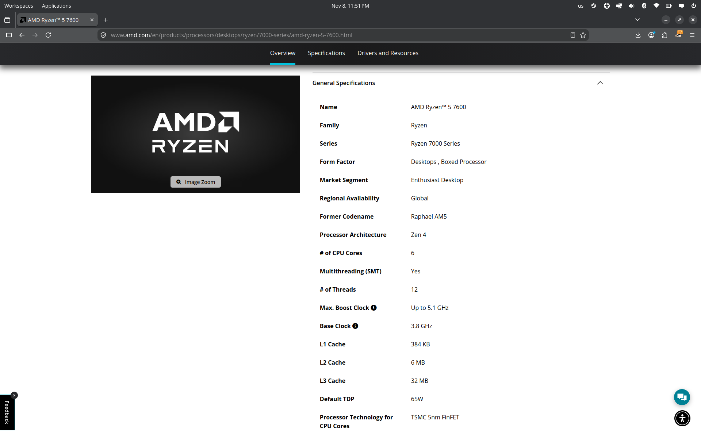
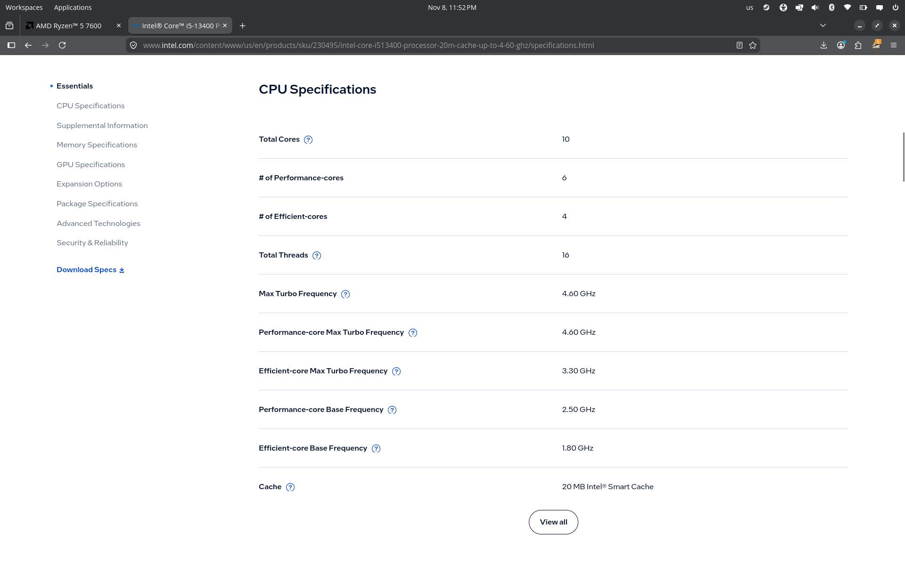
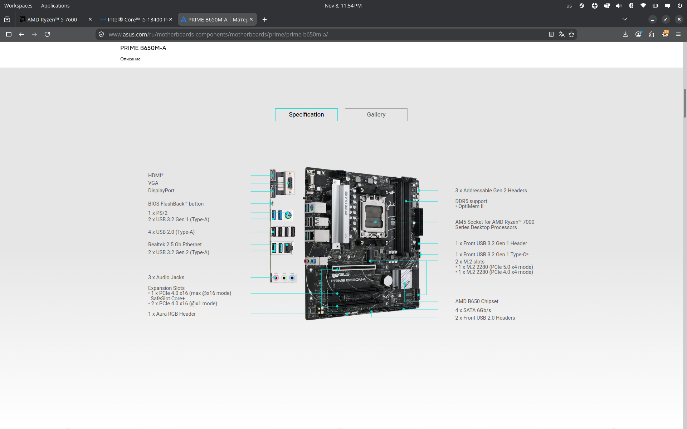
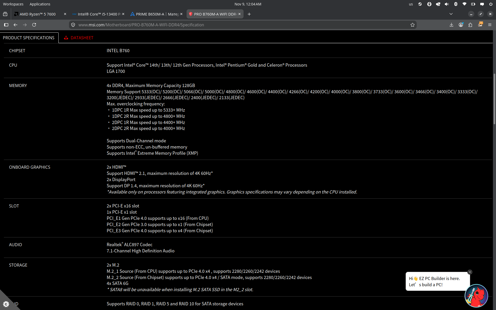
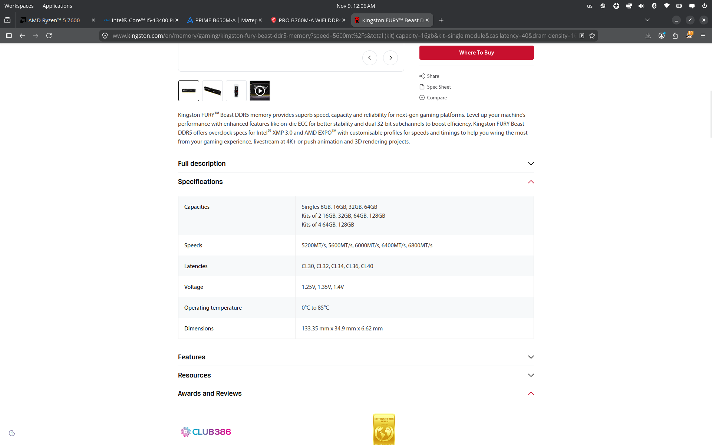
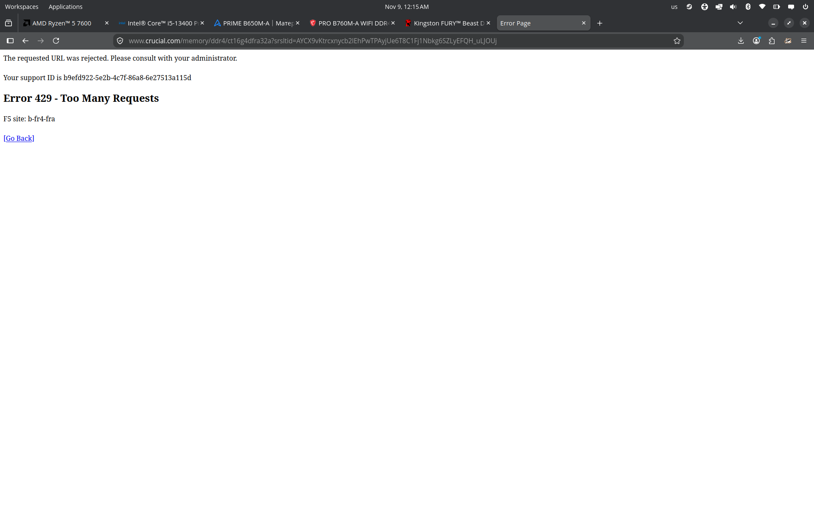
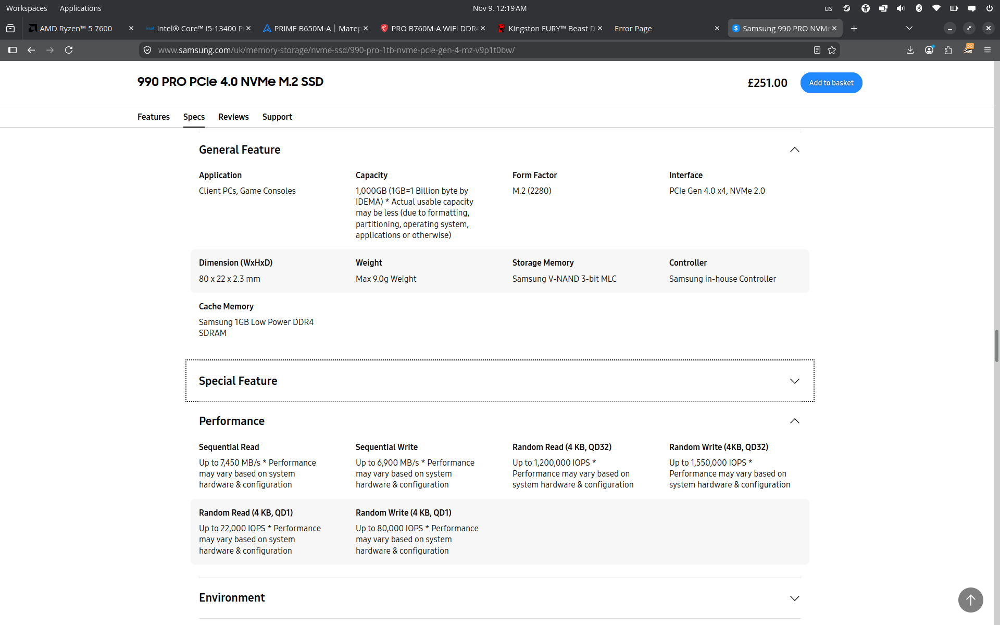
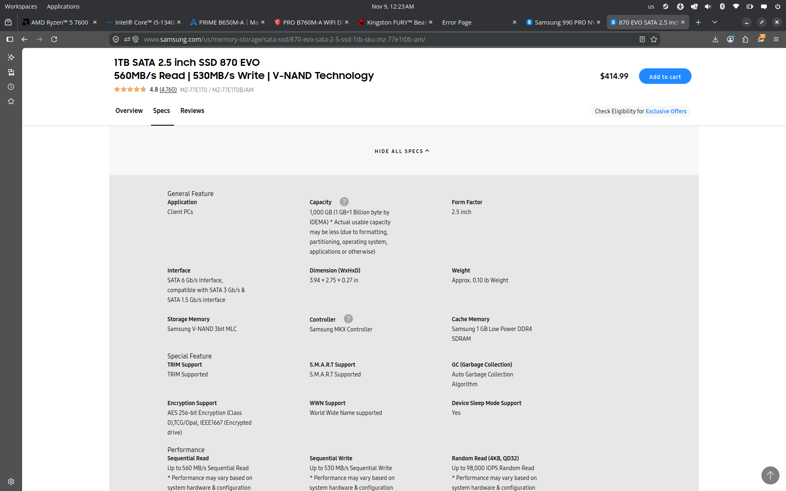
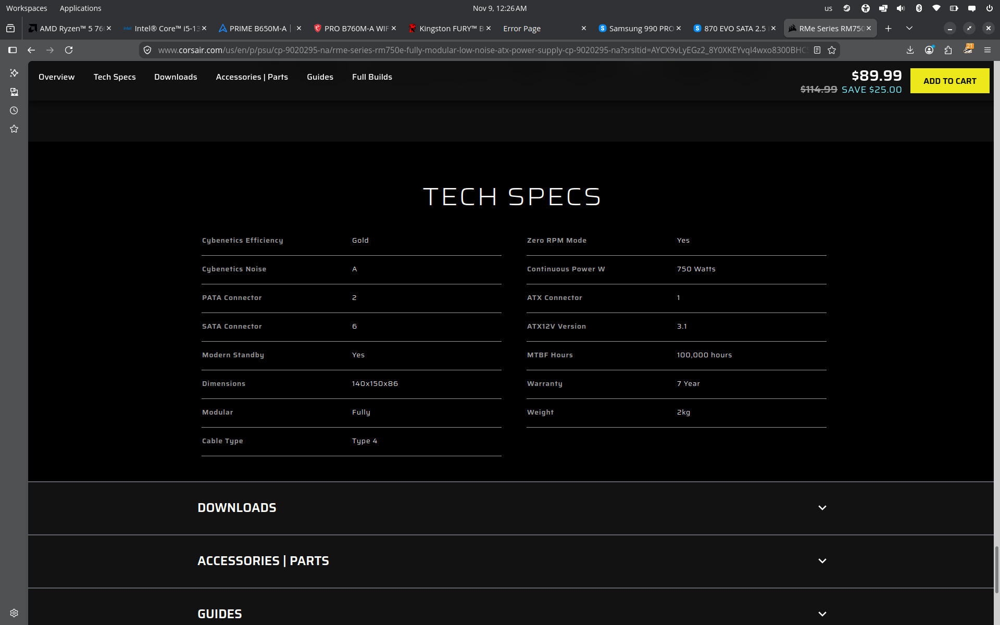
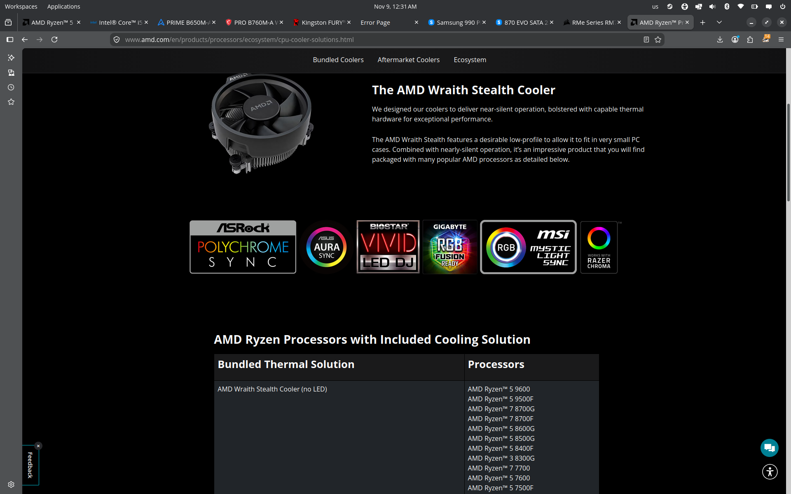

# Lab 3 — Teardown, and the same machine from the command line

Pair: <NAME 1> + <NAME 2> · Date: 8 November 2026

> Placeholders look like `<THIS>`. Replace every one before you commit. Numbers marked **(verify)** come from general knowledge; check them against the maker's Specifications tab and correct them if the page says something different.

---

## Part 1 — Ten parts

### 1. AMD Ryzen 5 7600

**What it is:** desktop processor, 6 cores / 12 threads, base 3.8 GHz, boost up to 5.1 GHz, 32 MB L3 cache, 65 W TDP, with a small integrated GPU. **Connects to:** socket AM5; its memory controller talks to DDR5 only (dual channel). **Limit:** fits only AM5 boards (e.g. B650), and DDR4 memory cannot be used with it at all.
Source: <maker's link, amd.com>

### 2. Intel Core i5-13400

**What it is:** desktop processor, 10 cores (6 Performance + 4 Efficient) / 16 threads, P-core boost up to 4.6 GHz, 20 MB cache, 65 W base power, integrated Intel UHD 730 graphics. **Connects to:** socket LGA1700; its memory controller supports both DDR5 (up to 4800 MT/s) and DDR4 (up to 3200 MT/s), but a board has slots for only one of them. **Limit:** fits only LGA1700 boards, and the board's memory slot type decides which DDR generation you get.
Source: <maker's link, intel.com (ARK page)>

### 3. ASUS PRIME B650M-A

**What it is:** micro-ATX motherboard with the AMD B650 chipset. **Connects to:** socket AM5, four DDR5 DIMM slots, M.2 NVMe slots (PCIe 4.0 x4) and SATA ports **(verify counts)**, 24-pin and CPU 8-pin power from the PSU. **Limit:** accepts only AM5 Ryzen processors (Ryzen 7000 and newer; the newest generations may need a BIOS update, see Step 3 below) and only DDR5 memory.
Source: <maker's link, asus.com>

### 4. MSI PRO B760M-A WIFI DDR4

**What it is:** micro-ATX motherboard with the Intel B760 chipset and built-in Wi-Fi. **Connects to:** socket LGA1700, four DDR4 DIMM slots, M.2 NVMe slots and SATA ports **(verify counts)**, 24-pin and CPU 8-pin power from the PSU. **Limit:** accepts only LGA1700 Intel processors (12th/13th/14th gen; check the CPU Support list for the BIOS version required) and only DDR4 memory. The "DDR4" in the name is the key detail: the same chipset also exists in DDR5 boards.
Source: <maker's link, msi.com>

### 5. Kingston FURY Beast DDR5-5600, 16 GB

**What it is:** DDR5 desktop DIMM, 16 GB, 5600 MT/s, 288 pins, about 1.25 V **(verify)**. **Connects to:** one DDR5 DIMM slot on the board, one module per memory channel slot. **Limit:** the notch is in a different position from DDR4, so it physically fits only DDR5 slots; speed is capped by what the CPU and board support (the Ryzen 5 7600 officially lists DDR5-5200, so 5600 runs through an XMP/EXPO profile).
Source: <maker's link, kingston.com>

### 6. Crucial DDR4-3200, 16 GB DIMM

**What it is:** DDR4 desktop DIMM, 16 GB, 3200 MT/s, 288 pins, 1.2 V. **Connects to:** one DDR4 DIMM slot on a DDR4 board. **Limit:** it also has 288 pins, but the notch is in a different place from DDR5, so it fits only DDR4 slots; 3200 MT/s is also the maximum DDR4 speed the i5-13400 officially supports.
Source: <maker's link, crucial.com (may redirect to micron.com)>

### 7. Samsung 990 PRO 1 TB

**What it is:** NVMe SSD, 1 TB, M.2 2280 form factor, PCIe 4.0 x4, sequential read up to about 7,450 MB/s **(verify)**. **Connects to:** an M.2 slot on the board; no cables needed. **Limit:** needs an M.2 slot with PCIe/NVMe support, and at full speed it needs a PCIe 4.0 x4 slot; it has no heatsink of its own, so it depends on the board's M.2 cover.
Source: <maker's link, samsung.com>

### 8. Samsung 870 EVO 1 TB

**What it is:** SATA SSD, 1 TB, 2.5″ form factor, SATA III 6 Gb/s, sequential read up to about 560 MB/s **(verify)**. **Connects to:** a SATA port on the board through a SATA data cable, plus a SATA power cable from the PSU, and a 2.5″ bay or bracket in the case. **Limit:** the SATA bus tops out at about 550 MB/s, so it is roughly 13 times slower than the 990 PRO no matter how fast the flash is.
Source: <maker's link, samsung.com>

### 9. Corsair RM750e (750 W)

**What it is:** ATX power supply, 750 W, 80 PLUS Gold, fully modular **(verify; also check which ATX version, 3.0 or 3.1, this revision lists)**. **Connects to:** the board (24-pin and CPU 8-pin), SATA power for drives, and PCIe power for a graphics card. **Limit:** total watts; a 65 W processor with no graphics card is far below 750 W, so the limit here is cables and connectors, not power.
Source: <maker's link, corsair.com>

### 10. Stock cooler (AMD Wraith Stealth, boxed with the Ryzen 5 7600)

**What it is:** the small air cooler that ships in the box with the Ryzen 5 7600. **Connects to:** the AM5 socket mounting holes, with a fan header on the board for power. **Limit:** heat removal; it is designed for a 65 W processor and cannot be mounted on an LGA1700 socket, so it cannot be used on the Intel build. **(verify: check on intel.com whether the boxed i5-13400 includes its own cooler; I believe it does, the Intel Laminar RM1.)**
Source: <maker's link, amd.com product page, "Includes cooler">

---

## Motherboards in detail

| | ASUS PRIME B650M-A | MSI PRO B760M-A WIFI DDR4 |
|---|---|---|
| Socket | AM5 | LGA1700 |
| Chipset | AMD B650 | Intel B760 |
| Form factor | micro-ATX | micro-ATX |
| Memory type / slots | DDR5, 4 DIMM slots | DDR4, 4 DIMM slots |
| M.2 slots | `<number, from spec page>` | `<number, from spec page>` |
| SATA ports | `<number, from spec page>` | `<number, from spec page>` |
| CPU support | AMD Ryzen 7000 and newer; `<BIOS update needed for the 7600? yes/no>` | Intel 12th/13th/14th gen; `<BIOS version needed for the i5-13400? from CPU Support list>` |

---

## Two builds

Rule used: match by socket, then memory type, then storage connection. Brand did not decide anything.

### Build 1 — AMD

| Part | Model | Why it fits here |
|---|---|---|
| Processor | AMD Ryzen 5 7600 | Socket AM5, so it can only go on the ASUS board. |
| Motherboard | ASUS PRIME B650M-A | Its AM5 socket matches the Ryzen 5 7600, and its DDR5 slots match the processor's DDR5-only memory controller. |
| Memory | Kingston FURY Beast DDR5-5600, 16 GB | DDR5 module for a DDR5 board; DDR4 would not fit the notch. |
| SSD | Samsung 990 PRO 1 TB | M.2 NVMe plugs straight into the board's PCIe 4.0 M.2 slot with no cables. |
| Cooler | AMD Wraith Stealth | Ships with the Ryzen 5 7600 and mounts on AM5; it cannot mount on LGA1700. |

### Build 2 — Intel

| Part | Model | Why it fits here |
|---|---|---|
| Processor | Intel Core i5-13400 | Socket LGA1700, so it can only go on the MSI board. |
| Motherboard | MSI PRO B760M-A WIFI DDR4 | Its LGA1700 socket matches, and its DDR4 slots are supported by the i5-13400 (DDR4-3200). |
| Memory | Crucial DDR4-3200, 16 GB | DDR4 module for a DDR4 board; it matches the i5-13400's official DDR4 maximum. |
| SSD | Samsung 870 EVO 1 TB | The board has SATA ports, so it works with a SATA data cable and a power cable. |
| Power supply | Corsair RM750e | Only one PSU is in the list; placed here because Build 1 already received the cooler. Either build could take it, and 750 W is far more than either needs. |

### What each build still needs

- **Build 1 (AMD):** a power supply (the only one went to Build 2), a case, a keyboard, a monitor and an operating system. No graphics card is required because the Ryzen 5 7600 has integrated graphics. Also needs a SATA-free design check: the 990 PRO needs no cables at all.
- **Build 2 (Intel):** a case with a 2.5″ drive bay, a SATA data cable (usually in the motherboard box), a keyboard, a monitor and an operating system. Cooling comes from the cooler in the i5-13400 box if the maker's page confirms it ships with one **(verify)**; otherwise it needs a separate LGA1700 cooler.
- **Both:** only one PSU, one stock cooler, and no case, display or peripherals were in the ten parts, so neither build can be switched on as is.

---

## Part 2 — Same facts, three operating systems

| Fact | Windows (PowerShell) | Linux | macOS |
|---|---|---|---|
| CPU model | `Get-CimInstance Win32_Processor \| Select Name` | `lscpu` (field "Model name") | `sysctl -n machdep.cpu.brand_string` |
| Cores / threads | `Get-CimInstance Win32_Processor \| Select NumberOfCores, NumberOfLogicalProcessors` | `lscpu` (fields "Core(s) per socket", "Thread(s) per core", "CPU(s)") | `sysctl hw.physicalcpu hw.logicalcpu` |
| Total memory | `Get-CimInstance Win32_PhysicalMemory \| Select Capacity` (add up the modules; value is in bytes) | `free -h` | `sysctl hw.memsize` |
| Memory modules and speed | `Get-CimInstance Win32_PhysicalMemory \| Select DeviceLocator, Capacity, Speed, ConfiguredClockSpeed, SMBIOSMemoryType, FormFactor` | `sudo dmidecode -t memory` | `system_profiler SPMemoryDataType` |
| Disk model and type | `Get-PhysicalDisk \| Select FriendlyName, MediaType, BusType, Size` | `lsblk -d -o NAME,MODEL,ROTA,TRAN,SIZE` | `diskutil info disk0` |
| Free space | `Get-Volume C` | `df -h /` | `df -h /` (or `diskutil info disk0`) |
| Architecture | `$env:PROCESSOR_ARCHITECTURE` | `uname -m` | `uname -m` |

If nobody in the pair has a Mac, delete the macOS column and say so here: `<no Mac available>`.

### What the output showed

**How the names differ.** The same fact has different names on each system: logical processors are `NumberOfLogicalProcessors` on Windows, `CPU(s)` in `lscpu` and `hw.logicalcpu` on macOS. The architecture is spelled `AMD64` on Windows, `x86_64` on Linux, and `arm64` or `x86_64` on macOS. Windows reports memory size in bytes, and its memory type is a number (`SMBIOSMemoryType`: 26 means DDR4, 34 means DDR5), while `dmidecode` prints the type and speed as text, in MT/s.

**What the VM showed differently from the host.** `<Fill in from your own output. Suggested points:>` `lscpu` in the VM shows the number of CPUs I assigned in VirtualBox/VMware (`<N>`), not the host's real count, and lists a "Hypervisor vendor" line. `lsblk` shows `<disk model, e.g. VBOX HARDDISK>` on `<sda / nvme0n1>` instead of my real SSD. `dmidecode` showed `<no module speed / virtual DIMM / ...>`. So the hypervisor passes through the CPU model and feature flags, but hides the physical memory modules, their speed, and the real disk and bus type.

**Apple Silicon (only if used).** `<macOS shows the chip name and total memory, but not individual modules or memory speed, because the memory is unified and on the same package as the chip.>`

---

## What did not work the first time

`<Write one real thing. Use this shape: what I saw → what it was → what I did.>`

Example shape (replace with your own, do not copy):
- I saw `<exact error or odd output>` when I ran `<command>`.
- It was `<cause>`.
- I fixed it by `<what you did>`, and the result was `<what changed>`.

---

## Evidence

- `evidence/photos/` — maker photos or screenshots, one per part (10 files).
- `evidence/windows-specs.txt` — each PowerShell command above its output (saved with `-Encoding utf8`).
- `evidence/linux-specs.txt` — each Linux command above its output, from `<Ubuntu VM / real hardware>`.
- `evidence/macos-specs.txt` — `<include only if a Mac was used>`.
