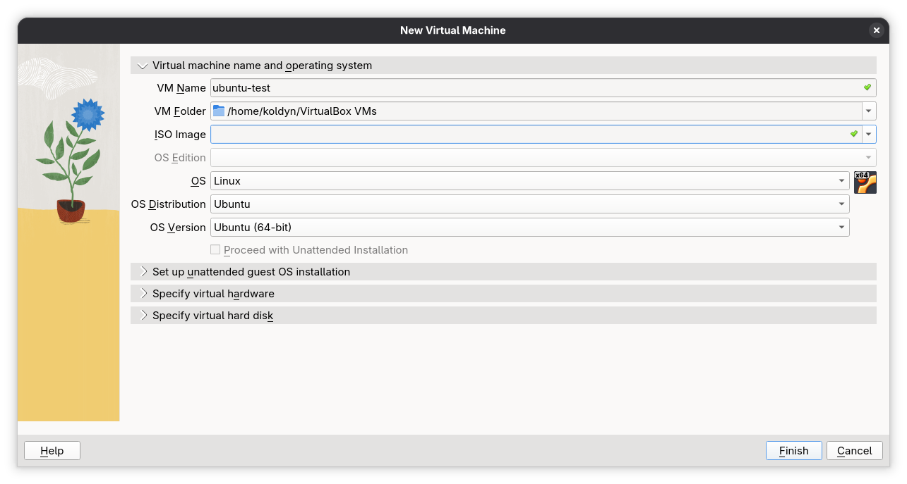
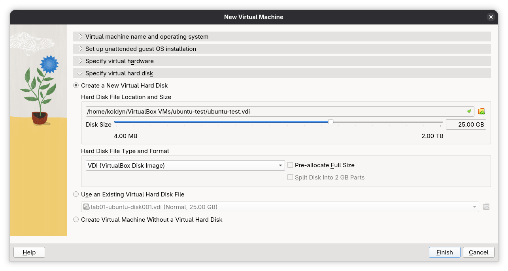
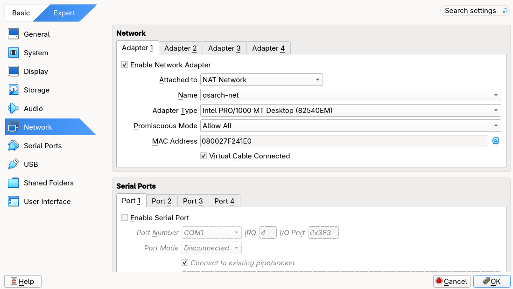
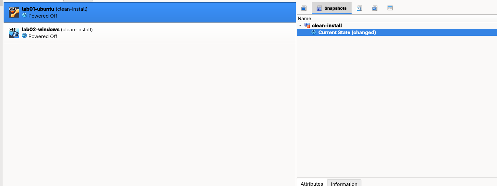

# Build guide: a safe test computer for a new developer

**Who this is for:** anyone who has never opened a virtual machine program.

**Works on:** Windows 10/11, Linux (Fedora, Ubuntu, Debian and similar) and Intel-based Macs. Steps that differ by system are marked **Windows**, **Linux** or **macOS**: follow only the one that matches your computer and skip the others.

> **Apple Silicon Macs (M1, M2, M3 or newer): this guide cannot be completed.** VirtualBox on those Macs can only run ARM guests, and the Windows 11 guest in Part 7 is not ARM. Use a tool built for Apple Silicon (UTM or Parallels) with ARM images. Everything else in this guide (planning, network idea, snapshots) still applies in principle.
> To check which Mac you have: Apple menu → **About This Mac**. "Chip: Apple M…" means Apple Silicon; "Processor: Intel…" means Intel.

**What you will end up with:** two test computers that live *inside* your normal computer:

| Name | What it is | Why the developer needs it |
|---|---|---|
| `ubuntu-test` | Linux (Ubuntu Server, text only) | Most servers run Linux; he can try server software here |
| `win11-test` | Windows 11 Enterprise (evaluation) | For testing anything that must work on Windows |

Both can see each other and the internet, and both have a **snapshot** (a "save point") so that anything he breaks can be undone in about a minute.

**How long it takes:** about 3 hours the first time, most of it waiting for installers. The second time, about 1.5 hours.

**How to read this document:** do the steps in order and do not skip the **Check** lines. Every step says what to do, then *why*.

**Where to type commands:**

| Your computer | Open this for commands on the host |
|---|---|
| **Windows** | Right-click Start → **Terminal** (or **Windows PowerShell**). Use **Terminal (Admin)** only where the text says so. |
| **Linux** | Open **Terminal** (usually Ctrl+Alt+T, or search for "terminal"). |
| **macOS** | Open **Terminal** (Cmd+Space, type `terminal`). |

Commands inside the guests are marked "in the Linux guest" or "in the Windows guest".

---

## Part 0. Words you will meet

| Word | Plain meaning |
|---|---|
| **Host** | Your real computer (the one on your desk). |
| **Guest** / **VM** | A pretend computer running inside the host. Has its own screen, disk and Windows/Linux. |
| **Hypervisor** | The program that creates and runs guests. We use **VirtualBox** (free). |
| **ISO** | A file that is a copy of an installation disc. |
| **vCPU** | A slice of the host's processor handed to a guest. |
| **Snapshot** | A saved state of a guest. You can return to it at any time. |
| **NAT Network** | A private virtual network inside VirtualBox. Guests on it can reach each other *and* the internet. |
| **Firmware (BIOS/UEFI)** | The first program your computer runs when it starts, before Windows/Linux. Some settings live only here. |
| **Host key** | The key that releases your mouse and keyboard from a VM window: **right Ctrl** on Windows and Linux, **left Cmd** on a Mac. |

---

## Part 1. Check that your computer can do this

Before installing anything, find out four things about the host: **processor cores, memory (RAM), storage, and whether virtualization is switched on.** The numbers decide how much you can give to each guest in Part 3. Use the commands, not the graphical "About" window: commands give exact numbers and you can save their output as proof.

> **Why first:** if virtualization is switched off in the firmware, VirtualBox installs fine and then refuses to start any guest, with an error that does not mention the real cause.

Create the folder for your evidence in the place where you keep this project, then follow the section for your system:

* **Windows:** `mkdir evidence -Force`
* **Linux / macOS:** `mkdir -p evidence`

### 1.1 Windows host

Run this block in a normal (non-admin) PowerShell. It prints the results and saves them to `evidence\00-host-check.txt`.

```powershell
Start-Transcript -Path evidence\00-host-check.txt
"### CPU: model, physical cores, threads"
Get-CimInstance Win32_Processor | Select-Object Name, NumberOfCores, NumberOfLogicalProcessors | Format-List
"### Memory: total GB"
[math]::Round((Get-CimInstance Win32_ComputerSystem).TotalPhysicalMemory / 1GB, 1)
"### Memory modules (count, size, speed)"
Get-CimInstance Win32_PhysicalMemory | Select-Object BankLabel, @{n='GB';e={$_.Capacity/1GB}}, Speed
"### Memory free right now, GB"
Get-CimInstance Win32_OperatingSystem | Select-Object @{n='FreeGB';e={[math]::Round($_.FreePhysicalMemory/1MB,1)}}
"### Disks: type and size"
Get-PhysicalDisk | Select-Object FriendlyName, MediaType, BusType, @{n='SizeGB';e={[math]::Round($_.Size/1GB)}}
"### Volumes: free space per drive letter"
Get-Volume | Where-Object DriveLetter | Select-Object DriveLetter, @{n='SizeGB';e={[math]::Round($_.Size/1GB)}}, @{n='FreeGB';e={[math]::Round($_.SizeRemaining/1GB)}}
"### Virtualization enabled in firmware?"
(Get-CimInstance Win32_Processor).VirtualizationFirmwareEnabled
systeminfo | Select-String "Hyper-V|hypervisor|Virtualization"
Stop-Transcript
```

| Line in output | What it means | Write down |
|---|---|---|
| `NumberOfCores` / `NumberOfLogicalProcessors` | Physical cores / threads. VirtualBox counts **threads** as "CPUs". | Both numbers |
| Memory total | Total RAM in GB | Total |
| Memory modules | One entry per installed stick. Two 8 GB sticks is not the same as one 16 GB stick. | Count and speed |
| `FreeGB` | RAM free right now | Free |
| `MediaType` | `SSD` is good. `HDD` (spinning disk) makes guests very slow. | Disk type |
| `FreeGB` on a drive letter | Free space on the drive that will hold the VMs. **Not** the disk's total size. | Free GB of that drive |
| `VirtualizationFirmwareEnabled` | `True` = on. | |

> **Check, a second way:** press **Ctrl+Shift+Esc** → **Performance** → **CPU**. At the bottom right it says **Virtualization: Enabled**. If PowerShell said `False` but Task Manager says **Enabled** (or `systeminfo` says "A hypervisor has been detected"), then Windows is already using virtualization for its own features. That counts as *on*; believe Task Manager.

### 1.2 Linux host

```bash
{
  echo "### OS / kernel";      cat /etc/os-release | head -2; uname -r
  echo; echo "### CPU: model, sockets, cores per socket, threads per core"
  lscpu | grep -E 'Model name|^Socket|Core\(s\) per socket|Thread\(s\) per core|^CPU\(s\)'
  echo "Logical CPUs (threads): $(nproc)"
  echo; echo "### Memory: total and free right now"
  free -h
  grep -E 'MemTotal|MemAvailable' /proc/meminfo
  echo; echo "### Memory modules (count, size, speed)"
  sudo dmidecode -t memory | grep -E 'Locator:|Size:|Speed:|Type:' | grep -v -E 'Bank|Error|No Module'
  echo; echo "### Disks: type and model (ROTA 0 = SSD, 1 = spinning HDD)"
  lsblk -d -o NAME,SIZE,ROTA,TRAN,MODEL
  echo; echo "### Free space on the drive where VMs will live (your home folder)"
  df -h ~
  echo; echo "### Virtualization"
  lscpu | grep -i 'Virtualization'
  echo "CPU flags vmx/svm found on $(grep -E -c '(vmx|svm)' /proc/cpuinfo) logical CPUs (0 = OFF or unsupported)"
  ls -l /dev/kvm 2>&1
  echo; echo "### Secure Boot state"
  mokutil --sb-state 2>&1
} 2>&1 | tee evidence/00-host-check.txt
```

If `dmidecode` or `mokutil` is "command not found": Fedora `sudo dnf install -y dmidecode mokutil`; Ubuntu/Debian `sudo apt install -y dmidecode mokutil`. Then run the block again.

| Line in output | What it means | Write down |
|---|---|---|
| `CPU(s)` / `Logical CPUs (threads)` | Number of threads, the number VirtualBox counts as "CPUs" | Threads |
| `Core(s) per socket` × `Socket(s)` | Physical cores | Cores |
| `MemTotal` / `free -h` total | Total RAM | Total |
| `MemAvailable` | RAM free *right now* | Free |
| Memory modules | One entry per installed stick | Count and speed |
| `ROTA 0` | SSD or NVMe. `ROTA 1` is a spinning disk (slow). | Disk type |
| `df -h ~` → `Avail` | Free space where VirtualBox keeps the VMs (home folder). **Not** the disk's total size. | Avail |
| `Virtualization: VT-x` (Intel) / `AMD-V`, count above 0, `/dev/kvm` exists | Virtualization is available **and** on | |
| `SecureBoot enabled/disabled` | Matters in Part 2 | State |

> **Check:** the `vmx`/`svm` count is **above 0** and `/dev/kvm` exists. If the count is `0`, go to 1.5.

### 1.3 macOS host (Intel Mac)

```bash
{
  echo "### CPU: model, physical cores, threads"
  sysctl -n machdep.cpu.brand_string hw.physicalcpu hw.logicalcpu
  echo; echo "### Memory: total"
  sysctl -n hw.memsize | awk '{printf "%.1f GB\n", $1/1024/1024/1024}'
  echo; echo "### Memory modules (count, size, speed)"
  system_profiler SPMemoryDataType | grep -E 'Size|Speed|Type|BANK|Slot'
  echo; echo "### Memory free right now (pages of 4096 bytes)"
  vm_stat | head -6
  echo; echo "### Disk: type and free space"
  diskutil info / | grep -E 'Solid State|Device / Media Name|Free Space|Container Free Space|Total Size'
  df -h /
  echo; echo "### Virtualization"
  sysctl kern.hv_support
  sysctl -n machdep.cpu.features | tr ' ' '\n' | grep -x VMX
} 2>&1 | tee evidence/00-host-check.txt
```

| Line in output | What it means |
|---|---|
| `hw.physicalcpu` / `hw.logicalcpu` | Cores / threads |
| `hw.memsize` | Total RAM |
| `Solid State: Yes` | SSD. `No` = spinning disk (slow). |
| `Container Free Space` | Free space for the VMs (on APFS, this is the number that counts; `df` can under-report) |
| `kern.hv_support: 1` and a `VMX` line | Virtualization available. On a Mac it is always on; there is no firmware setting to change. |

### 1.4 Write your numbers down

Fill in this table. Part 3 uses it.

| What | My value | Command that gave it |
|---|---|---|
| CPU model | | |
| Physical cores / threads | / | |
| Total RAM (GB) | | |
| RAM modules (count, speed) | | |
| RAM free right now (GB) | | |
| Disk type | | |
| Free space on VM drive (GB) | | |
| Virtualization enabled? | | |
| Secure Boot (Linux only) | | |

### 1.5 If virtualization is OFF: switch it on (Windows and Linux)

1. Restart into the firmware settings:
   * **Windows 11/10:** Settings → System → Recovery → **Advanced startup: Restart now** → Troubleshoot → Advanced options → **UEFI Firmware Settings** → Restart.
   * **Linux (systemd):** `systemctl reboot --firmware-setup`
   * Or on any computer: shut down, power on and tap the firmware key at once: usually **F2**, **Del**, **F10** or **Esc**. The maker's logo screen often prints it.
2. Find the virtualization setting. It is under *Advanced*, *CPU Configuration* or *Security*. The name is **Intel Virtualization Technology** (also "VT-x") on Intel, or **SVM Mode** on AMD.
3. Set it to **Enabled**, save and exit (usually **F10**).
4. Back in your system, repeat the check from 1.1 or 1.2.

> **Why this is a firmware setting:** the operating system cannot turn it on by itself; only the firmware can, which is why no download fixes this.

---

## Part 2. Install the hypervisor (VirtualBox)

**Why VirtualBox:** it is free, it has the same screens on every host system, and it has snapshots and a private virtual network built in. Alternatives exist (VMware Workstation, Hyper-V, KVM with `virt-manager`); this guide uses VirtualBox so that every step, including the snapshots in Parts 6 and 7, works the same way on every host.

You do **not** need the VirtualBox *Extension Pack* for this guide. Skip it.

### 2.1 Windows host

1. Open **https://www.virtualbox.org/wiki/Downloads** and click **Windows hosts**. Save the installer.
2. Run it. Click **Next** through the pages and keep the default components.
3. A warning says the installation will **briefly disconnect your network**. Click **Yes**. This is normal: the installer adds a virtual network adapter. Do not do this in the middle of a video call.
4. Leave **Start VirtualBox after installation** ticked and click **Finish**.

The command-line tool is `VBoxManage`. In PowerShell it is not found by name. Run this once in **every** new PowerShell window before using any `VBoxManage` command in this guide:
```powershell
Set-Alias VBoxManage "C:\Program Files\Oracle\VirtualBox\VBoxManage.exe"
VBoxManage --version
```

> **Check:** the second command prints a version such as `7.x.x`.

### 2.2 Linux host

**First, Secure Boot.** VirtualBox adds a small piece to Linux itself (a "kernel module"). If Secure Boot is on, Linux refuses it because Oracle's code has no signature. Run:
```bash
mokutil --sb-state
```
* `SecureBoot disabled` → no problem, continue.
* `SecureBoot enabled` → either switch Secure Boot off in the firmware (same screen as in 1.5, usually under *Boot* or *Security*), or let the installer create a signing key. **Ubuntu/Debian** do this for you: during the installation a blue "Configuring Secure Boot" screen asks you to choose a password; after the restart a blue **MOK management** screen appears: choose **Enroll MOK → Continue → Yes**, type the same password. **Fedora** needs the key made by hand; search "VirtualBox Fedora Secure Boot MOK" and follow it, or switch Secure Boot off. Switching it off on the host does not affect the Windows guest, which has its own virtual Secure Boot (Part 7).

**Then install**, using the block for your distribution.

**Ubuntu / Debian / Linux Mint:**
```bash
sudo apt update
sudo apt install -y virtualbox virtualbox-guest-additions-iso
sudo usermod -aG vboxusers "$USER"
```

**Fedora** (kernel headers must match the running kernel, so update and reboot first):
```bash
sudo dnf upgrade --refresh -y
sudo reboot
```
After the restart:
```bash
sudo dnf install -y kernel-devel kernel-headers gcc make perl elfutils-libelf-devel bzip2 wget
rpm -q kernel-devel-"$(uname -r)"        # must print a package name, not "is not installed"
sudo wget https://download.virtualbox.org/virtualbox/rpm/fedora/virtualbox.repo -O /etc/yum.repos.d/virtualbox.repo
dnf search VirtualBox                    # shows the newest package, e.g. VirtualBox-7.2
sudo dnf install -y VirtualBox-7.2       # use the name that search printed
sudo usermod -aG vboxusers "$USER"
```

**Other distributions:** use the packages from https://www.virtualbox.org/wiki/Linux_Downloads.

**Log out and log in again** (a restart also works), then:
```bash
id | grep vboxusers            # must print your groups including vboxusers
VBoxManage --version           # prints a version such as 7.x.x
lsmod | grep ^vbox             # lists vboxdrv, vboxnetflt, vboxnetadp
```
Start VirtualBox from your applications menu.

> **Check:** `lsmod` prints three `vbox…` lines and VirtualBox Manager opens.

**If `lsmod` prints nothing,** the kernel modules were not built: run `sudo /sbin/vboxconfig` and read its last lines. "Secure Boot" → see above. "kernel headers" → install `kernel-devel` (Fedora) or `linux-headers-$(uname -r)` (Ubuntu/Debian), then repeat. After every kernel update the modules may need `sudo /sbin/vboxconfig` again. If Oracle's Fedora package keeps failing on a brand-new kernel, install VirtualBox from the RPM Fusion repository instead (`dnf search virtualbox` after enabling RPM Fusion Free) and remove Oracle's package first.

### 2.3 macOS host (Intel)

1. Open **https://www.virtualbox.org/wiki/Downloads** and click **macOS / Intel hosts**. Open the `.dmg` and run the installer.
2. macOS blocks the driver the first time. Open **System Settings → Privacy & Security**, scroll down, click **Allow** next to the message about "Oracle America, Inc.", then **restart** the Mac.
3. If the installer failed because of the block, run the installer again after the restart.

> **Check:** in Terminal `VBoxManage --version` prints a version. If it says "command not found", use the full path `/Applications/VirtualBox.app/Contents/MacOS/VBoxManage` or add it to your PATH.

---

## Part 3. Plan the resources (do this before creating anything)

A guest takes real memory, real processor time and real disk space from the host. If you give the guests too much, the host itself starts struggling and everything slows down, including the guests.

Use your table from section 1.4 and these rules:

| Resource | Rule | Why |
|---|---|---|
| **vCPUs** | Each guest gets **at most half** of your threads. Never more than your threads in total. | The host needs processor time to do its own job. |
| **RAM** | Both guests together use **at most half** of your total RAM. Windows 11 needs at least 4 GB; Ubuntu Server runs fine on 2 GB. | Your own system and a browser already use 3–6 GB. Take half and the host keeps enough. |
| **Disk** | Ubuntu 25 GB, Windows 80 GB. Together they must fit in the free space with **at least 20% of the drive still free**. | Windows 11 refuses to install below 64 GB. |

**Example only (not your numbers):** a host with 16 GB RAM, 8 threads and 300 GB free →

| Guest | vCPUs | RAM | Disk |
|---|---|---|---|
| `ubuntu-test` | 2 | 2 GB | 25 GB |
| `win11-test` | 4 | 6 GB | 80 GB |
| **Total** | 6 of 8 | 8 of 16 GB (50%) | 105 of 300 GB |

Write **your** table here before continuing:

| Guest | vCPUs | RAM | Disk |
|---|---|---|---|
| `ubuntu-test` | | | |
| `win11-test` | | | |

> **Why "disk" is less scary than it sounds:** we choose a *dynamically allocated* disk. The file starts small and grows only as the guest writes data, up to the limit you set. An 80 GB Windows disk uses about 25–30 GB on the host right after installation. VirtualBox keeps the disks in a folder called `VirtualBox VMs` in your user folder; it must be on the drive whose free space you measured.

---

## Part 4. Get the installation files

You need two ISO files from the shared folder: **Ubuntu Server LTS** and **Windows 11 Enterprise Evaluation**. Copy both into one folder in your user folder, called `ISO`.

**Check that the copies are not corrupted** by comparing the checksum with the one on the download page:

| Host | Command |
|---|---|
| **Windows** | `Get-FileHash $HOME\ISO\<filename>.iso -Algorithm SHA256` |
| **Linux** | `sha256sum ~/ISO/<filename>.iso` |
| **macOS** | `shasum -a 256 ~/ISO/<filename>.iso` |

> **Why:** a half-copied ISO installs 90% of the way and then fails with a confusing error. Ten seconds of checking saves an hour.

> **Licensing:** use only the **evaluation** Windows image from the shared folder. Never type a licence key into it and never download a "ready-activated" Windows from a website. The evaluation works for **90 days**; after that it shows a warning and restarts itself every hour. Build a new guest from this document when that happens. To see the days left: `slmgr /dlv` in the Windows guest.

---

## Part 5. The private network (create it once, before the guests)

**The trap:** VirtualBox's default network mode is called **NAT**, and it gives every guest its *own* private bubble. Guests in separate bubbles **cannot see each other**, even though both reach the internet. To let them talk we create a **NAT Network**: one shared bubble that both guests join.

**Why not Bridged:** a bridged guest appears on the office network as if it were a separate physical computer, with its own hardware (MAC) address. Many office networks, including Innotech's teaching network, silently reject addresses they do not know, so the guest gets no network and no error message. A NAT Network hides the guests behind the host's own address, which the office network already trusts. (If you build this at home and need to reach a guest from another machine, Bridged is the better choice.)

1. In VirtualBox Manager open **File → Tools → Network Manager** (in some versions: **File → Preferences → Network**; on a Mac: **VirtualBox → Settings → Network**).
2. Open the **NAT Networks** tab and click **Create**.
3. Set **Name** `osarch-net`, **IPv4 Prefix** `10.0.50.0/24`, tick **Enable DHCP**. Click **Apply**.

Same thing from the command line, if you prefer (Windows: after the `Set-Alias` line from 2.1):
```bash
VBoxManage natnetwork add --netname osarch-net --network "10.0.50.0/24" --enable --dhcp on
VBoxManage natnetwork list
```

> **Check:** `osarch-net` appears in the list with `DHCP: Yes` and `Enabled: Yes`.

---

## Part 6. The Linux guest: `ubuntu-test`

### 6.1 Create the machine

1. In VirtualBox Manager click **New**.
2. **Name:** `ubuntu-test`. **ISO Image:** choose the Ubuntu Server ISO from your `ISO` folder. Type and Version fill in automatically (Linux / Ubuntu 64-bit); correct them if not.
3. Tick **Skip Unattended Installation**. *Why:* the automatic installer hides every choice from you, and you need to see them to rebuild this later.
4. Click **Next**. On the hardware page enter **your** numbers from Part 3: **Base Memory** (in MB: 2 GB is 2048) and **Processors**.
5. On the disk page choose **Create a Virtual Hard Disk Now**, enter **your size** (25 GB), and leave **Pre-allocate Full Size** *unticked* (see "dynamically allocated" in Part 3).
6. Click **Finish**. Do not start it yet.



### 6.2 Settings to change before the first start

Select `ubuntu-test` → **Settings**.

* **Storage:** check the `.vdi` disk is the size you set.

  

* **Network → Adapter 1:** *Attached to:* **NAT Network**, *Name:* `osarch-net`. This is the single most important setting in this document.

  

* **System → Boot Order:** make sure **Optical** comes before **Hard Disk**, so it starts from the ISO on the first run.

> **Check:** the summary on the right of VirtualBox Manager shows your memory, the ISO and `NAT Network 'osarch-net'`.

### 6.3 Install Ubuntu Server

Click **Start**. A window opens with a text installer. The mouse does not work: use **arrow keys**, **Tab**, **Space** to tick, **Enter** to confirm.

> **Tip:** when you click inside the VM window, it captures your keyboard and mouse. Press the **Host key** (see Part 0) to get them back.

| Screen | What to choose | Why |
|---|---|---|
| Language | English | Error messages are easier to search in English. |
| Installer update | **Continue without updating** | Faster; updates are installed later. |
| Keyboard | Your layout | |
| Type of install | **Ubuntu Server** (not the minimized one) | The minimized one lacks tools used later. |
| Network | Leave DHCP. You should see an address like `10.0.50.x` | Proves the NAT Network works before you go on. |
| Proxy | Empty | |
| Mirror | Default | |
| Storage | **Use an entire disk**, keep the defaults | The disk is virtual and belongs only to this guest, so nothing on your own computer's disk can be damaged. |
| Profile | Your name; server name `ubuntu-test`; username and a password you will remember | |
| Ubuntu Pro | Skip | Not needed. |
| SSH | **Install OpenSSH server** (tick it, no key import) | The text-only guest cannot copy and paste. With SSH you can fetch its output files (see 6.4). |
| Snaps | Select nothing | |


Wait for **Install complete!**, then choose **Reboot Now**. If it asks you to remove the installation medium, press **Enter**. If it boots into the installer again, shut the VM down (see 6.5) and, in **Settings → Storage**, remove the ISO from the optical drive.

At the `login:` prompt enter your username and password.

### 6.4 First checks (in the Linux guest)

```bash
{ lsb_release -a; uname -a; } | tee ~/04-guest-uname.txt
ip addr | tee ~/08-ip-addr-linux.txt
ping -c 4 1.1.1.1
ping -c 4 ubuntu.com
```

* `lsb_release -a` should say *Ubuntu* and a version.
* `ip addr` should show an address `10.0.50.x`. **Write it down**; you need it in Part 8.
* The first `ping` proves the internet path; the second proves that names are translated to addresses (DNS). If the first works and the second does not, the problem is DNS, not the cable.

Update the system:
```bash
sudo apt update && sudo apt upgrade -y
```

**Getting the evidence files out of this guest:** it is text-only and cannot copy and paste. Once the Windows guest exists (Part 7), run this **in the Windows guest** (the built-in `scp` command), with the Linux guest's address and user name:
```powershell
scp <linux-user>@<linux-address>:04-guest-uname.txt .
scp <linux-user>@<linux-address>:08-ip-addr-linux.txt .
```
This also proves the two guests can talk. Then move the files to your own computer through the shared clipboard (7.4) or paste their contents into new files on the host. A photo of the screen is an acceptable fallback if you say so in the report.

### 6.5 Shut down correctly, then take the first snapshot

Always shut a Linux guest down with:
```bash
sudo poweroff
```
*Why:* closing the window instead is like pulling the plug on a real computer.

In VirtualBox Manager select `ubuntu-test` → **Snapshots** (button at the top right) → **Take**. Name it exactly `clean-install`. Description: "Fresh Ubuntu Server, updated, nothing changed".

Or in the host's terminal:
```bash
VBoxManage snapshot ubuntu-test take clean-install --description "Fresh Ubuntu Server, updated"
VBoxManage snapshot ubuntu-test list
```

> **Why now:** the snapshot is only useful if you take it *before* touching anything. A snapshot taken after the damage preserves the damage.

### 6.6 Prove the safety net works (break it on purpose, then undo it)

A snapshot you have never restored is a hope, not a safety net. Test it.

1. Start the VM, log in and delete the hostname file (in the Linux guest):
   ```bash
   cat /etc/hostname          # shows: ubuntu-test
   sudo rm /etc/hostname
   cat /etc/hostname          # No such file or directory  → broken
   sudo reboot
   ```
2. After the reboot, the login prompt shows `localhost` instead of `ubuntu-test`. That confirms the damage.

3. Shut the guest down (`sudo poweroff`).
4. In **Snapshots**, select `clean-install` → **Restore**. If VirtualBox asks to save the current state, choose **Discard** (the current state is the damaged one).
5. Start the VM and check:
   ```bash
   cat /etc/hostname          # shows ubuntu-test again
   ```
6. Show the snapshot list for the evidence (on the host):
   ```bash
   VBoxManage snapshot ubuntu-test list
   ```
   

> **Check:** the file is back and the prompt says `ubuntu-test`.

---

## Part 7. The Windows guest: `win11-test`

Windows 11 refuses to install without three things: **UEFI firmware, a TPM 2.0 chip and Secure Boot**. A virtual machine has none of them unless you switch them on, so the settings below are not optional. Do **not** use any registry trick to bypass the checks: the machine would be unsupported and fail later updates. (VirtualBox provides the virtual TPM itself; nothing extra needs installing.)

### 7.1 Create the machine

1. **New** → **Name:** `win11-test`, **ISO Image:** the Windows 11 evaluation ISO. Type *Microsoft Windows*, Version *Windows 11 (64-bit)*.
2. Tick **Skip Unattended Installation**.
3. Hardware: **your** memory and processors (at least 4096 MB and 2 CPUs). Tick **Enable EFI**.
4. Disk: **your** size (80 GB; the minimum Windows 11 accepts is 64 GB). Leave *Pre-allocate* unticked.
5. **Finish**.

### 7.2 Settings to change before the first start

Select `win11-test` → **Settings**:

* **System → Motherboard:** tick **Enable EFI**, set **TPM** to **v2.0**, tick **Enable Secure Boot**.
* **Display → Screen:** **Video Memory** to **128 MB**. *Why:* the default makes the Windows 11 desktop sluggish.
* **General → Advanced → Shared Clipboard:** **Bidirectional**. *Why:* lets you copy text between your computer and the guest (works after 7.4).
* **Network → Adapter 1:** **NAT Network**, name `osarch-net`. (Same as the Linux guest.)

> **Check:** the summary on the right shows EFI, TPM 2.0, 128 MB video memory and `NAT Network 'osarch-net'`.

### 7.3 Install Windows

Click **Start**. If you see *Press any key to boot from CD or DVD*, press a key **immediately**, because you have five seconds. If you miss it, a UEFI shell appears; type `exit`, choose **Boot Manager** and pick the DVD.

1. Language and keyboard → **Next** → **Install now**.
2. **"I don't have a product key"**. Do not enter any key. (It is the evaluation edition; no key is needed.)
3. Choose the **Windows 11 Enterprise (Evaluation)** edition → accept the licence terms.
4. **Custom: Install Windows only** → select the single unallocated drive → **Next**. It restarts several times. *Do not press a key* at the "boot from CD" prompt again.
5. First-run screens: region *Kazakhstan*, keyboard layout. When asked for sign-in, choose **Sign-in options → Domain join instead** to create a **local account** (no Microsoft account needed). Pick a user name and password.
6. Decline the optional privacy items.

### 7.4 Guest Additions (makes the guest comfortable)

In the VM window menu: **Devices → Insert Guest Additions CD image**. In Windows open **File Explorer → CD Drive (VirtualBox Guest Additions)** → run `VBoxWindowsAdditions.exe` → accept defaults → restart.

If VirtualBox says it cannot find the Guest Additions image: on **Ubuntu/Debian hosts** install it (`sudo apt install virtualbox-guest-additions-iso`) and try again; on any host you can instead download `VBoxGuestAdditions_<version>.iso` from https://download.virtualbox.org/virtualbox/ (open the folder of your version), then attach it in the VM's **Settings → Storage** as an optical disc.

*Why this matters:* without it the screen stays tiny, the mouse sticks to the window and you cannot copy text between your computer and the guest. With it you can, and that is how you will get command output out of the guest for evidence.

### 7.5 First check and the first snapshot (in the Windows guest)

Open **Terminal (Admin)**: right-click Start → **Terminal (Admin)**.

```powershell
ipconfig /all | Tee-Object -FilePath $HOME\Desktop\07-ipconfig-windows.txt
ping 1.1.1.1
```
The `IPv4 Address` should be `10.0.50.x`. **Write it down.**

Shut the guest down from Windows (Start → Power → Shut down), then take the snapshot on the host, exactly as in 6.5:

```bash
VBoxManage snapshot win11-test take clean-install --description "Fresh Windows 11 Enterprise evaluation with Guest Additions"
VBoxManage snapshot win11-test list
```

---

## Part 8. Make the two guests talk to each other

Start both guests. You need the two addresses you wrote down: the Linux one from 6.4 (`10.0.50.x`) and the Windows one from 7.5.

### 8.1 Linux → Windows (this will fail the first time)

In the Linux guest:
```bash
ping -c 4 <windows-address>
```
It fails with `100% packet loss`. **This is expected.** The network is fine: the **Windows firewall** drops "echo requests" (ping) by default.

### 8.2 The right fix: one specific rule, not "turn the firewall off"

Turning the firewall off removes *all* protection to fix *one* problem. Instead allow only ping, only from the local network. In the **Windows guest**, in **Terminal (Admin)**:

```powershell
New-NetFirewallRule -DisplayName "Allow ping from local subnet (ICMPv4)" `
  -Direction Inbound -Protocol ICMPv4 -IcmpType 8 `
  -RemoteAddress LocalSubnet -Action Allow -Profile Any

Get-NetFirewallRule -DisplayName "Allow ping from local subnet*" | Format-Table DisplayName, Enabled, Action
```

> **Check:** the rule is listed with `Enabled: True`, `Action: Allow`. The firewall itself must still say **On**: `Get-NetFirewallProfile | Format-Table Name, Enabled`.

### 8.3 Test both directions

Ubuntu has no firewall switched on by default (`sudo ufw status` says `inactive`), so the other direction works at once.

Linux → Windows (in the Linux guest):
```bash
ping -c 4 <windows-address> | tee ~/05-ping-linux-to-windows.txt
```
Windows → Linux (in the Windows guest):
```powershell
ping <linux-address> | Tee-Object -FilePath $HOME\Desktop\05-ping-windows-to-linux.txt
```
Both should show replies and `0% loss`. Join the two outputs into one file on your computer, `evidence/05-ping-between-guests.txt`, with a line above each saying which direction it is.

Internet from each guest:
```bash
ping -c 4 1.1.1.1 && ping -c 4 ubuntu.com        # Linux guest
```
```powershell
ping 1.1.1.1; Resolve-DnsName microsoft.com      # Windows guest
```

> **If a ping fails, the order of suspects is:** (1) is the adapter set to `osarch-net` on **both** guests? (2) do both addresses start with `10.0.50.`? (3) the firewall rule from 8.2 (4) typo in the address. See Troubleshooting.

---

## Part 9. Test what happens when you promise too much memory

This shows why Part 3 exists. **Close and save all your work first:** your host may become very slow or freeze for a minute, and the operating system may stop a program on its own to save itself.

**1. Measure the host with both guests shut down.** Use the block for your system; each one saves a file and prints it. Also take a screenshot of the graphical memory view: **Windows** Task Manager → Performance → Memory; **Linux** System Monitor → Resources; **macOS** Activity Monitor → Memory.

**Windows** (PowerShell):
```powershell
& { Get-Date
    Get-CimInstance Win32_OperatingSystem | Select-Object @{n='TotalGB';e={[math]::Round($_.TotalVisibleMemorySize/1MB,1)}}, @{n='FreeGB';e={[math]::Round($_.FreePhysicalMemory/1MB,1)}}
    Get-Counter '\Memory\Available MBytes','\Paging File(_Total)\% Usage' } | Tee-Object -FilePath evidence\09-memory-before.txt
```
**Linux:**
```bash
{ date; free -h; grep -E 'MemTotal|MemAvailable|SwapTotal|SwapFree' /proc/meminfo
  swapon --show; cat /proc/pressure/memory; } | tee evidence/09-memory-before.txt
```
**macOS:**
```bash
{ date; vm_stat | head -8; sysctl vm.swapusage; memory_pressure | tail -3; } | tee evidence/09-memory-before.txt
```

**2.** In each guest's **Settings → System**, raise **Base Memory** so that the two together are **more than your host's total RAM** (host 16 GB: 10 GB each). VirtualBox warns you; continue.

**3.** Start both guests and wait two minutes. Run the same block again, saving to `evidence/10-memory-after.txt`, and take the second screenshot.

**4. Find out what your system did about it:**

| Host | Command |
|---|---|
| **Windows** | `Get-WinEvent -FilterHashtable @{LogName='System'; ProviderName='Microsoft-Windows-Resource-Exhaustion-Detector'} -MaxEvents 5 -ErrorAction SilentlyContinue` (no output means Windows logged nothing) |
| **Linux** | `journalctl -k -b \| grep -i -E 'out of memory\|oom\|killed process'` and `journalctl -b -u systemd-oomd --no-pager \| tail -20` |
| **macOS** | `log show --last 15m --predicate 'process == "kernel" AND eventMessage CONTAINS[c] "memorystatus"' \| tail -20` (may print nothing) |

**5.** Write down what happened: did one guest refuse to start? Did a guest get killed? Did the host slow down? Did swap (paging) usage rise? Any outcome is a valid result: write what you observed, not what you expected.

**6. Put the memory back** to the values from Part 3 on both guests. Restore a guest to its `clean-install` snapshot only if something got damaged.

> **Why it works this way:** every system first moves less-used memory out to the disk (or, on Fedora and macOS, into a compressed area of memory) to make room. That keeps working but gets slower. When even that is full, the system either stops the biggest program (usually a VM) or refuses to start the next one. This is why the rule is "half, not everything".

---

## Part 10. Handing it over: final checks

Tick every line before giving the machine to the developer:

- [ ] `VBoxManage list vms` shows `ubuntu-test` and `win11-test`.
- [ ] Both guests start, and `ip addr` / `ipconfig` show `10.0.50.x` addresses.
- [ ] Both guests ping the internet **and** each other.
- [ ] The Windows firewall in the guest is still **On**, with the one ping rule added.
- [ ] Memory values are back to the Part 3 plan.
- [ ] `VBoxManage snapshot ubuntu-test list` and `VBoxManage snapshot win11-test list` both show `clean-install`.
- [ ] You wrote down: guest user names, passwords (in the company password manager, not on paper in this document) and the date the Windows evaluation expires (install date + 90 days).
- [ ] **Linux hosts only:** you know that after a kernel update VirtualBox may stop working until you run `sudo /sbin/vboxconfig` (see Troubleshooting).

**What to tell the developer, in one paragraph:** "These two computers are yours to break. If something stops working and you cannot fix it, shut the machine down, open VirtualBox, choose **Snapshots**, select `clean-install` and click **Restore**. You will lose everything you did since the snapshot, but you will have a working machine again. Copy anything you want to keep to a USB drive or the office share first."

---

## Troubleshooting

| Host | What you see | What it means | What to do |
|---|---|---|---|
| All | `VT-x is not available` or `VERR_VMX_NO_VMX` | Virtualization is switched off in the firmware | Section 1.5 |
| All | `This PC can't run Windows 11` during setup | The VM lacks UEFI, TPM or Secure Boot | Section 7.2: all three must be set; then restart the setup |
| All | Linux guest boots into the installer again after the install | ISO is still in the virtual drive | Shut down, **Settings → Storage**, remove the ISO |
| All | Windows setup stuck on a black screen with a `Shell>` prompt | You missed the "press any key" window | Type `exit`, pick **Boot Manager → DVD** |
| All | Guest has no IP address, or `169.254.x.x` / no `10.0.50.x` | Adapter is not on `osarch-net`, or DHCP is off | Section 5 step 3 and the adapter settings; restart the guest |
| All | Guests reach the internet but not each other | They are in separate NAT bubbles (plain *NAT*) | Both adapters must be *NAT Network* with the **same** name |
| All | Windows → Linux ping works, Linux → Windows does not | The Windows firewall | Section 8.2 |
| All | Bridged mode: guest gets no address on the office network | The office network blocks unknown hardware addresses | Use NAT Network (Part 5) |
| All | `ping google.com` fails but `ping 1.1.1.1` works | DNS problem only | `resolvectl status` (Ubuntu guest) or `ipconfig /all` (Windows guest): check the DNS servers |
| All | Keyboard or mouse stuck inside the VM window | The guest has captured them | Press the **Host key** (Part 0) |
| All | Windows guest shows "evaluation copy expires" / restarts hourly | The 90-day evaluation ended | Build a new Windows guest from Part 7 |
| Windows | `VBoxManage` is "not recognized" | Alias not set in this window | `Set-Alias VBoxManage "C:\Program Files\Oracle\VirtualBox\VBoxManage.exe"` |
| Windows | Guests very slow; a green turtle icon in the VirtualBox status bar | Windows features (Hyper-V, WSL2, Memory integrity) share virtualization with VirtualBox | Acceptable for this task. To speed up: *Turn Windows features on or off* → untick **Hyper-V**, **Virtual Machine Platform**, **Windows Hypervisor Platform**, restart. WSL2 stops working until you tick them again |
| Linux | `VERR_VM_DRIVER_NOT_INSTALLED`, "Kernel driver not installed (rc=-1908)" | Kernel modules are not built or not loaded | `sudo /sbin/vboxconfig`; if it complains: Secure Boot or headers (2.2) |
| Linux | Worked yesterday, fails today after an update | A new kernel arrived and the modules were not rebuilt | Reboot into the new kernel, install the matching headers, `sudo /sbin/vboxconfig` |
| Linux | `VERR_VMX_IN_VMX_ROOT_MODE`, "VT-x is being used by another hypervisor" | KVM is holding the processor (for example while `virt-manager` or GNOME Boxes guests run) | Shut those guests down, or `sudo modprobe -r kvm_intel` (Intel) / `sudo modprobe -r kvm_amd` (AMD) |
| Linux | No permission for `/dev/vboxdrv`, or the VM list is empty | You are not in `vboxusers`, or you did not log out since being added | `sudo usermod -aG vboxusers "$USER"`, then log out and in |
| macOS | Installer fails or "Kernel driver not installed" | macOS blocked the driver | Part 2.3 step 2: **Privacy & Security → Allow**, restart, install again |
| macOS | `VBoxManage: command not found` | It is not on the PATH | Use `/Applications/VirtualBox.app/Contents/MacOS/VBoxManage` |
| macOS (Apple chip) | Windows 11 guest will not run | Apple Silicon cannot run x64 guests in VirtualBox | See the note at the top of this guide |
